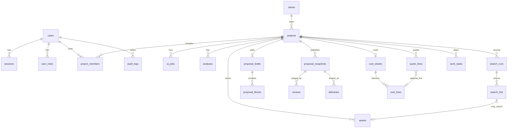

# 11. 开源核验与建设对照

核对日期：2026-10-16。本篇记录核验结论。基础框架随后提交在 `cursor/app-foundation-aff7`，没有新增 GrapesJS，也没有业务表。

业务登录、编辑器和模型调用都还没实现。登录页只是说明文字。

## 11.1 当前仓库里有什么

| 位置 | 现状 |
| --- | --- |
| `package.json` | Next.js 16.4.2、React 19.3.1、React DOM 19.3.1、TypeScript 5.9.3、Tailwind CSS 4.3.3、Prisma 6.19.3。Node 引擎 `>=22`。没有 GrapesJS。 |
| `prisma/schema.prisma` | 只声明 PostgreSQL 数据源，没有模型。 |
| `src/app/api/health/route.ts` | 唯一已实现接口：`GET /api/health`，响应 `{ "status": "ok" }`。 |
| `src/app/page.tsx` | 说明基础框架就绪，登录、编辑、豆包和报价尚未实现。 |
| `src/app/login/page.tsx` | 文案占位。写明账号由管理员开通、认证尚未接入，不能登录。 |
| `src/server/ai/adapter.ts` | 只有类型：供应商 `volcengine-ark`，模型 `doubao-seed-evolving`。没有分析方法。 |
| `src/server/config.ts` | 上传在 `UPLOAD_MAX_BYTES` 或允许的 MIME 未配置时拒绝。会话时长和锁定次数未配置则为空，不写死小时数。模型必须是该 Model ID，且基址和密钥都非空，否则视为未配置。 |
| `src/worker/index.ts` | 只打印配置是否齐全。不连接 Redis，不调用方舟。 |
| `src/components/ui/button.tsx` | shadcn 风格按钮，供后台外壳使用。 |
| `src/server/{auth,projects,assets,search,pricing,tasks,review,audit}/` | 空目录占位。 |
| `src/proposal/templates/` | 空目录占位。 |
| `docker-compose.yml` | PostgreSQL 16、Redis 7、MinIO、web、Nginx 1.27。Nginx 监听映射到宿主 8080。 |
| `docker/nginx.conf` | `client_max_body_size 1`，即 1 字节。这是限制未配置时的入口拒绝，不是业务上的上传上限。 |
| 测试 | 健康检查、配置策略、环境样例、客户端不得引用 `src/server`。 |

## 11.2 已安装依赖的许可证

来源是当前 `package-lock.json` 中直接依赖的 `license` 字段。传递依赖没有逐个打开许可证原文。

| 包 | 版本 | 许可证 | 在本系统中的用途 |
| --- | --- | --- | --- |
| next | 16.4.2 | MIT | App Router、页面与路由处理函数 |
| react / react-dom | 19.3.1 | MIT | 界面 |
| @types/react / @types/react-dom | 19.2.2 | MIT | 类型 |
| typescript | 5.9.3 | Apache-2.0 | 类型检查 |
| tailwindcss / @tailwindcss/postcss | 4.3.3 | MIT | 后台样式 |
| @radix-ui/react-slot | 1.2.3 | MIT | shadcn 按钮的 `asChild` |
| class-variance-authority | 0.7.1 | Apache-2.0 | 按钮变体 |
| clsx、tailwind-merge | 2.1.1 / 3.3.1 | MIT | 类名合并 |
| @prisma/client、prisma | 6.19.3 | Apache-2.0 | 数据访问。表尚未定义 |
| eslint、eslint-config-next | 9.39.1 / 16.4.2 | MIT | 检查 |
| prettier | 3.6.2 | MIT | 格式 |
| postcss | 8.5.6 | MIT | Tailwind 管线 |
| vitest | 5.0.5 | MIT | 单元测试 |
| tsx | 4.20.6 | MIT | 运行 worker 入口 |
| @types/node | 22.19.1 | MIT | Node 类型 |

这些包可以继续作为工程底座。shadcn 按钮只服务后台外壳，不进入客户 HTML。

## 11.3 GrapesJS

核验对象：npm `grapesjs@0.23.8`（登记更新时间 2026-10-15），以及仓库 `packages/core/LICENSE`。

- 许可证：**BSD-3-Clause**。版权人 Artur Arseniev，2017 至 current。
- 再分发须保留版权声明、条件与免责声明。
- 未经书面许可，不得用 “GrapesJS” 或其贡献者的名字为本产品背书。
- 运行时依赖：`backbone@1.4.1`、`backbone-undo@0.2.6`、`@types/backbone@1.4.15`、`codemirror@5.63.0`、`codemirror-formatting@1.0.0`、`html-entities@~1.4.0`、`promise-polyfill@8.3.0`、`underscore@1.13.8`。这些传递许可证本轮未逐份打开。

可复用：

- 浏览器里的画布、组件模型、样式、撤销（`backbone-undo`）、block 注册、traits。
- 草稿保存我们自己的工程 JSON。官方示例把 `storageManager` 关掉，不使用它的 localStorage。

不复用：

- **GrapesJS Studio SDK**。官方 README 把它标成可嵌入的商业产品，含团队支持。本期不购买、不接入。
- `grapesjs-preset-webpage` 及通用网页 block。它们没有报价行 ID、素材 ID、授权状态这些 traits，不能当成提案模板。
- 内置资源管理器的本地上传。素材只走本系统的项目素材接口。
- 整页源码模式。第 10 篇已排除。

接入时在仓库保留 BSD 声明，产品文案不把本系统称为 GrapesJS 官方产品。

## 11.4 `@grapesjs/react`

核验对象：npm `@grapesjs/react@2.0.0`（2025-02-20 发布，登记更新 2026-03-06）及其 README。

- 许可证：**MIT**。
- peer：`grapesjs@^0.22.5`，`react` / `react-dom` 为 `^18 || ^19`。
- 同一版本又把 `react@^19`、`react-dom@^19` 及对应 `@types/*` 写进 dependencies。安装后要确认进程里只有一份 React。若出现两份，编辑器钩子会和页面树断开。
- 官方说明：这个包装器给画布**外面**做 React 界面，不把 React 组件画进 GrapesJS 画布。
- 可用导出：`GjsEditor`、`Canvas`、`useEditor`、`useEditorMaybe`、`WithEditor`。
- 必须在客户端加载（`"use client"`，或 `dynamic(..., { ssr: false })`）。Backbone 与 CodeMirror 不能进服务端渲染。

可复用范围就是这层挂载和取编辑器实例。提案 block、traits、保存和发布仍自行开发。

## 11.5 与当前 Next.js / React 的兼容性

| 项 | 当前工程 | 官方范围 | 结论 |
| --- | --- | --- | --- |
| React | 19.3.1 | v2：18 或 19 | 落在 peer 范围内 |
| GrapesJS | 尚未安装；拟用 0.23.8 | peer `^0.22.5` | 0.23.8 满足该范围 |
| Next.js | 16.4.2 | v2 README 写的是 Next.js 15.x；v1 写的是 14.x | **文档矩阵没有 Next.js 16**。没有声明 Next 的 peer，也没有本仓库的运行验证 |

因此：版本号上 React 与 GrapesJS 可以对上；Next.js 16 是文档缺口，不是已证实可运行。下一轮若开工，先做只含客户端编辑器的最小探针，确认一份 React、画布能挂上、服务端构建不拉入 Backbone。本轮不执行 `npm install`。

探针通过之前，不把 GrapesJS 写进客户链接或服务端渲染路径。

## 11.6 agencykit

这个名字对应两个互不相关的产品。两者都**不作为本系统的可复用代码**。

### agencykit.app

托管的代理商工作台（客户、项目、协作、账单）。条款（2025-03-13）写明：服务及其原创内容、功能归 AgencyKit Inc. 及其许可方专有。用户保留自己上传内容的所有权。没有可复制的源代码许可证。

不复用其界面、字段或账单逻辑。本系统的报价没有利润公式，也不能从该产品推断税率或币种。

### `@agency-kit/notion-cms`

GitHub `agency-kit/notion-cms`，包名 `@agency-kit/notion-cms`，版本 0.10.0，许可证 **MIT**（Copyright 2023 Jacob Milhorn）。它把 Notion 变成静态站点的无头 CMS，依赖 `@notionhq/client`、`marked`、`sharp`、`zod` 等。同组织还有 MIT 的 11ty 起步模板。

它与 GrapesJS、报价、任务、提案快照无关。本系统不接 Notion，所以复用范围为无。MIT 只说明若另做 Notion 站点可以遵守该许可证使用，不表示它可以充当提案编辑器。

若 “agencykit” 指的是上述两者之外的仓库，需要另给地址后再核验。在那之前不引入同名依赖。

## 11.7 系统架构

```text
浏览器（员工）
  Next.js 页面 + shadcn 后台
  提案编辑页：仅客户端的 GrapesJS
        │ 会话 Cookie
        ▼
Next.js 路由处理函数
  认证、项目隔离、财务可见
  报价/素材 traits 在发布前重写
        │
        ├─ PostgreSQL（Prisma，表尚未建）
        ├─ 对象存储 MinIO：客户素材、转存副本、快照 HTML/CSS、PDF
        └─ Redis + BullMQ（计划中，worker 尚未消费）
                │
                ▼
        火山方舟 doubao-seed-evolving
        生成时调用 web_search
        只转存工具真正返回的 URL

客户浏览器
  Nginx :8080 → web:3000
  GET /p/:token 读取冻结 HTML
  不加载 GrapesJS，不创建客户账号
```

发布顺序保持第 5 篇：草稿 JSON 中的报价行 ID、素材 ID 先按表重写，再消毒导出 HTML/CSS，写入快照；PDF 用无头浏览器打印这份 HTML，不另做版式。成本、利润、任务和内部备注不进客户 HTML。

## 11.8 目录：已有与待建

```text
docs/planning/                 已有。本篇在此
prisma/schema.prisma           已有，无模型。待建迁移
src/app/                       已有布局、首页、占位登录、健康检查
src/app/(console)/             待建：项目、素材、分析、报价、任务、审核
src/app/projects/[id]/edit/    待建：客户端 GrapesJS 页
src/app/p/[token]/             待建：客户只读快照
src/components/ui/             已有 Button。其余 shadcn 按页面再加
src/components/editor/         待建：GjsEditor 封装，禁止服务端引用
src/proposal/templates/        已有空目录。待建 HTML/CSS 片段与 block
src/server/ai/adapter.ts       已有类型。待建 analyze / generate / regenerate
src/server/config.ts           已有上传、会话、模型策略
src/server/health.ts           已有
src/server/auth|projects|assets|search|pricing|tasks|review|audit/
                               已有空目录。待建实现
src/worker/index.ts            已有配置日志。待建队列与 PDF
tests/unit/                    已有四项。待建业务夹具
tests/integration|e2e/         待建
docker-compose.yml、docker/    已有。不在本篇改 Nginx 字节数
```

## 11.9 数据库 ER（目标）

Prisma 当前没有这些表。下图是第 5 篇的目标，供实现时建迁移。金额用 `numeric(14,2)`。币种可空，不设默认币种和汇率。



要点：

- `user_roles`：`admin`、`editor`、`reviewer`，一人可多条。枚举名称仍是假设。
- `users.finance_access`：财务可见开关。没有财务可见的人不能读写成本、报价和利润区。
- `project_members`：非管理员只能看见自己参与的项目。
- `proposal_drafts`：一项目一份。源数据是 GrapesJS 工程 JSON（组件、样式、traits），不是整页 HTML 字符串。`proposal_blocks` 若与工程 JSON 重复，实现时二选一：要么 JSON 为唯一草稿、块表只作索引，要么块表为源、JSON 为导出缓存。本篇取前者，与第 10 篇一致，避免两套草稿。
- `proposal_snapshots`：追加写入。含发布时的工程 JSON、HTML/CSS 存储键、PDF 存储键、对客报价副本。旧链接保持指向旧快照。
- `deliveries.token_hash`：明文只在创建响应出现一次。`expires_at` 可空，不强制过期。`revoked_at` 撤销。归档不自动撤销。
- `quote_lines.visible_in_proposal`：只有这些行进入客户 HTML。空报价显示「尚未填写对客报价」，不显示 0。
- 利润不建公式表。接口对有财务可见的成员返回「未配置」。
- `work_tasks` 由人创建。没有行业模板，没有建议来源。
- `assets.license_status` 默认 unknown，仅编辑侧可见。网络案例保持外部引用说明；只有工具返回的 URL 或手工补链才转存。

## 11.10 API 清单

前缀除客户页外为 `/api`。除健康检查和 `/p/:token` 外都要登录。写操作走第 6 篇的权限。列表用 `limit` 与游标。

**已实现**

| 方法 | 路径 | 现状 |
| --- | --- | --- |
| GET | `/api/health` | 返回 `{ "status": "ok" }`。不探测数据库、Redis 或密钥 |

**待实现**

| 分组 | 方法与路径 |
| --- | --- |
| 会话 | `POST /api/auth/login`，`POST /api/auth/logout`，`GET /api/auth/me` |
| 账号 | `GET, POST /api/users`，`PATCH /api/users/:id`。无自助注册 |
| 客户与项目 | `GET, POST /api/clients`，`GET, PATCH /api/clients/:id`，`GET, POST /api/projects`，`GET, PATCH /api/projects/:id`，`POST /api/projects/:id/members`，`DELETE /api/projects/:id/members/:userId` |
| 素材 | `GET, POST /api/projects/:id/assets`，`GET /api/assets/:id/content`，`DELETE /api/assets/:id` |
| 分析 | `POST, GET, PATCH /api/projects/:id/analysis`，`POST /api/projects/:id/analysis/confirm`，`GET /api/jobs/:id` |
| 搜索 | `GET /api/projects/:id/searches`，`POST /api/search-hits/:id/dismiss`，`POST /api/projects/:id/references` |
| 提案 | `POST, GET /api/projects/:id/proposal/draft`，`PATCH /api/proposal-blocks/:id`（若块只是 JSON 内节点，则改为按组件 id 更新 traits），`POST .../blocks`，`POST .../reorder`，`DELETE /api/proposal-blocks/:id`，`POST .../regenerate`，`GET .../preview`，`POST .../publish`，`GET .../snapshots`，`GET /api/snapshots/:id` |
| 成本报价 | `GET, PUT /api/projects/:id/cost-sheet`，`GET, PUT /api/projects/:id/quote-lines`，`GET /api/projects/:id/profit` |
| 任务 | `GET, POST /api/projects/:id/tasks`，`PATCH /api/tasks/:id` |
| 审核交付 | `POST /api/snapshots/:id/submit`，`POST /api/snapshots/:id/reviews`，`POST /api/snapshots/:id/deliveries`，`POST /api/deliveries/:id/revoke`，`GET /p/:token` |
| 审计 | `GET /api/projects/:id/audit-logs`（管理员） |

字段与拒绝条件仍以第 3、5、6 篇为准。删除整块是否允许见 Q11，默认只做隐藏。

## 11.11 开发任务

编号沿用第 7 篇。下表只标相对当前磁盘的缺口。

| 编号 | 内容 | 相对现状 |
| --- | --- | --- |
| T0 | 阻塞项书面结论 | 产品规则已写入。API Key、MIME/字节、Q9、Q11、Q13、Q14、Q16、Q17、Q18 仍开放 |
| T1 | 工程骨架 | 已在工作区：脚本、Compose、健康检查、配置策略、空目录。未在本篇提交 |
| T2 | 数据模型 | 未开始。按 11.9 建迁移 |
| T3 | 本地口令、会话、角色、财务开关、项目隔离 | 登录页不能登录 |
| T4 | 客户、项目、成员、归档 | 未开始 |
| T5 | 上传与对象存储 | 策略会拒绝未配置的上传。没有存储实现 |
| T6 | 豆包分析与人工确认 | 适配器只有类型。无密钥则失败，不改派模型 |
| T7 | 解析 `web_search` 并转存工具 URL | 未开始。不接第二家搜索 |
| T8 | HTML/CSS 模板、消毒、报价与素材重写 | 目录为空 |
| T9 | GrapesJS 编辑页与乐观锁 | 依赖 11.5 的探针。shadcn 继续只做外壳 |
| T10 | 预览、快照、同源 PDF | 未开始 |
| T11 | 成本、对客报价、利润「未配置」 | 未开始 |
| T12 | 手工任务 | 未开始 |
| T13 | 单人审核、可撤销链接、旧链接读旧快照 | 未开始 |
| T14 | 审计 | 未开始 |
| T15 | 端到端验收 | 未开始 |
| T16 | 部署演练 | Compose 与 Nginx 已在。本机此前未启动过这套容器 |

依赖顺序不变：T2 之后才能做 T3；T6 与 T8 汇合后做 T7、T9；T10 读 T11 的报价（可以为空）；T13 在快照可发布之后。

## 11.12 复用与自研

| 能力 | 决定 |
| --- | --- |
| Next.js、React、TypeScript、Tailwind、Prisma、PostgreSQL、Redis、MinIO、Nginx、Vitest | 复用已安装或已编写的工程底座 |
| shadcn / Radix 按钮及以后的后台表单 | 复用组件写法，只用于员工后台 |
| GrapesJS 画布、撤销、组件、样式、block、traits | 复用 BSD-3-Clause 核心。保留声明，不做名称背书 |
| `@grapesjs/react` 的编辑器挂载 | 复用 MIT 包装器。先过 Next 16 探针，并避免双份 React |
| 提案 HTML/CSS 模板与 block | 自研 |
| traits 中的报价行 ID、素材 ID，以及发布前重写 | 自研 |
| HTML 消毒与客户页禁止脚本 | 自研 |
| 豆包适配器、`web_search` 结果提取 | 自研。只使用方舟该模型 |
| 转存与 SSRF 限制 | 自研。模型自写的媒体 URL 丢弃 |
| 账号、会话、角色、财务开关、项目隔离 | 自研 |
| 成本、报价、未配置利润、手工任务 | 自研 |
| 审核、分享令牌、快照冻结、PDF 打印 | 自研 |
| 审计 | 自研 |
| GrapesJS Studio SDK | 不使用 |
| 通用网页 preset、编辑器 localStorage | 不使用 |
| agencykit.app | 不使用。专有托管服务，无源码许可 |
| `@agency-kit/notion-cms` | 不使用。MIT，但是 Notion 静态站工具 |

## 11.13 本轮没有做的事

- 没有 `npm install grapesjs` 或 `@grapesjs/react`。
- 没有改业务源码、锁文件、Prisma、Compose、Nginx。
- 没有运行时验证 GrapesJS 在 Next.js 16.4.2 上的画布。
- 没有逐份打开 GrapesJS 传递依赖的许可证原文。
